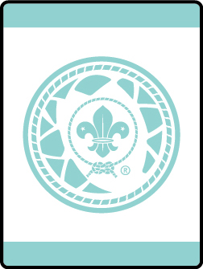

# Champions for Nature Bear Bear Adventure

- **Adventure name:** Champions for Nature Bear
- **Rank:** Bear
- **Type:** Elective
- **Category:** 

## Overview

We have three important resources for all living things on our planet: water, soil, and air. We use water to clean ourselves, our dishes, and our clothes. Soil is the resource that allows us to grow food. The air we breathe goes into our lungs, providing our bloodstream with oxygen. In this Adventure, you’ll discover more about the resources of water, soil, and air and perhaps put what you discover into use with a conservation project. Knowing more about the resources of the planet will help you make good decisions about conserving the resources of our world.

## Requirements

### Requirement 1

Discover natural resources.

**Activities:**

- **[Build A World](https://www.scouting.org/cub-scout-activities/build-a-world/)** (Indoor, energy 3, supplies 2, prep 2)
  
- **[Natural Resources Scavenger Hunt](https://www.scouting.org/cub-scout-activities/natural-resources-scavenger-hunt/)** (Travel, energy 4, supplies 4, prep 5)
  Cub Scouts learn about natural resources with a scavenger hunt.
- **[Natural Resources Walk](https://www.scouting.org/cub-scout-activities/natural-resources-walk/)** (Travel, energy 4, supplies 2, prep 5)
  Cub Scouts will  identify  natural resources while taking a walk outside.

### Requirement 2

Discover what happens to the wastewater in your community.

**Activities:**

- **[Water Conservation Charades](https://www.scouting.org/cub-scout-activities/water-conservation-charades/)** (Indoor, energy 4, supplies 2, prep 2)
  Cub Scouts will learn ways of conserving water by playing charades.
- **[Water Management Facility Tour](https://www.scouting.org/cub-scout-activities/water-management-facility-tour/)** (Travel, energy 3, supplies 1, prep 5)
  Cub Scouts tour their local  ​ ​ water management facility.
- **[Where Does Wastewater Go?](https://www.scouting.org/cub-scout-activities/where-does-wastewater-go/)** (Indoor, energy 2, supplies 3, prep 2)
  Cub Scouts make a poster showing what happens to wastewater in their community.

### Requirement 3

Investigate soil.

**Activities:**

- **[Aqua Pollution Adventure](https://www.scouting.org/cub-scout-activities/aqua-pollution-adventure/)** (Indoor, energy 3, supplies 3, prep 2)
  Cub Scouts  demonstrate  how pollution can enter our groundwater.
- **[DIY Composter](https://www.scouting.org/cub-scout-activities/diy-composter/)** (Indoor, energy 4, supplies 4, prep 2)
  Cub Scouts will build their own composter.
- **[Soil Investigation](https://www.scouting.org/cub-scout-activities/soil-investigation/)** (Indoor, energy 3, supplies 4, prep 2)
  Cub Scouts will investigate different soils.

### Requirement 4

Investigate air pollution.

**Activities:**

- **[Acid Rain Investigation](https://www.scouting.org/cub-scout-activities/acid-rain-investigation/)** (Indoor, energy 3, supplies 3, prep 2)
  Cub Scouts conduct an acid rain experiment.
- **[Air Pollution Investigation](https://www.scouting.org/cub-scout-activities/air-pollution-investigation/)** (Indoor, energy 3, supplies 3, prep 2)
  Cub Scouts investigate air pollution.
- **[Human Air Pollution Detectors](https://www.scouting.org/cub-scout-activities/human-air-pollution-detectors/)** (Indoor, energy 2, supplies 2, prep 2)
  In this activity, Cub Scouts will be “indoor pollution detectors” to investigate air pollution.

### Requirement 5

Participate in a conservation project.

**Activities:**

- **[Bears Plant Trees](https://www.scouting.org/cub-scout-activities/bears-plant-trees/)** (Travel, energy 3, supplies 5, prep 4)
  Cub Scouts plant trees for a local organization.
- **[Clean Waterways](https://www.scouting.org/cub-scout-activities/clean-waterways-bear/)** (Outdoor, energy 4, supplies 3, prep 5)
  In celebration of the 70th anniversary of the Conservation Good Turn for America, Scouting America is joining the nationwide initiative aimed at addressing the critical issue of waterway and marine debris, “aquatic trash”, offering Scouts the opportunity to make a meaningful impact on the health of our waterways and ecosystems.
- **[Planting Native Plants](https://www.scouting.org/cub-scout-activities/planting-native-plants/)** (Travel, energy 4, supplies 5, prep 4)
  Cub Scouts will add native plants to a garden for the chartered partner, school, or other community location.

## Resources

- [Champions for Nature Bear Bear adventure page](https://www.scouting.org/cub-scout-adventures/champions-for-nature-bear/)

Note: This is an unofficial archive of Cub Scout Adventures that was automatically extracted from the Scouting America website and may contain errors.