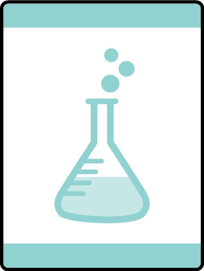

# Super Science Bear Adventure

- **Adventure name:** Super Science
- **Rank:** Bear
- **Type:** Elective
- **Category:** 

## Overview

Have you ever wondered why the sky is blue or how gravity works or what makes a rainbow? Scientists wonder about those things, too.

## Requirements

### Requirement 1

Conduct static electricity investigation.

**Activities:**

- **[Dancing Foil](https://www.scouting.org/cub-scout-activities/dancing-foil/)** (Indoor, energy 2, supplies 2, prep 1)
  Foil reaction to static electricity.
- **[Race the Can](https://www.scouting.org/cub-scout-activities/race-the-can/)** (Indoor, energy 4, supplies 2, prep 2)
  Cub Scouts use static electricity to push a can.
- **[The Static Detective Lab](https://www.scouting.org/cub-scout-activities/the-static-detective-lab/)** (Indoor, energy 3, supplies 2, prep 2)
  Cub Scouts explore static electricity using a plastic comb.

### Requirement 2

Conduct the sink-or-float investigation.

**Activities:**

- **[Hot vs. Cold Lab](https://www.scouting.org/cub-scout-activities/hot-vs-cold-lab/)** (Indoor, energy 3, supplies 2, prep 2)
  Cub Scouts explore how temperature affects how water moves and mixes—and they actually  see it happen .
- **[Sink or Float Relay](https://www.scouting.org/cub-scout-activities/sink-or-float-relay/)** (Outdoor, energy 4, supplies 3, prep 2)
  Cub Scouts race to determine if objects sink or float.
- **[Sink or Swim](https://www.scouting.org/cub-scout-activities/sink-or-swim/)** (Indoor, energy 2, supplies 2, prep 2)
  Cub Scouts learn about experiment variables.
- **[The Boat Challenge](https://www.scouting.org/cub-scout-activities/the-boat-challenge/)** (Indoor, energy 3, supplies 2, prep 2)
  Cub Scouts will build a boat to hold as many pennies as possible.

### Requirement 3

Conduct the color-morphing investigation.

**Activities:**

- **[Magic Milk Color Explosion Lab](https://www.scouting.org/cub-scout-activities/magic-milk-color-explosion-lab/)** (Indoor, energy 3, supplies 2, prep 2)
  Cub Scouts will create a magical color explosion and investigate what happens.
- **[Oil and Water](https://www.scouting.org/cub-scout-activities/oil-and-water/)** (Indoor, energy 3, supplies 3, prep 2)
  Cub Scouts test to see if liquids mix together.
- **[Walking Rainbow](https://www.scouting.org/cub-scout-activities/walking-rainbow/)** (Indoor, energy 3, supplies 2, prep 1)
  Cub Scouts become Color Scientists investigating how colors travel, mix, and magically change!

### Requirement 4

Conduct the color-layering investigation.

**Activities:**

- **[Create a Rainbow](https://www.scouting.org/cub-scout-activities/create-a-rainbow/)** (Indoor, energy 3, supplies 3, prep 2)
  Cub Scouts create a rainbow using 3 simple ingredients.
- **[Rainbow Bottle Lab](https://www.scouting.org/cub-scout-activities/rainbow-bottle-lab/)** (Indoor, energy 3, supplies 3, prep 2)
  Cub Scouts create a  stacked rainbow inside a bottle  using different liquids that naturally form layers.

## Resources

- [Super Science Bear adventure page](https://www.scouting.org/cub-scout-adventures/super-science/)

Note: This is an unofficial archive of Cub Scout Adventures that was automatically extracted from the Scouting America website and may contain errors.