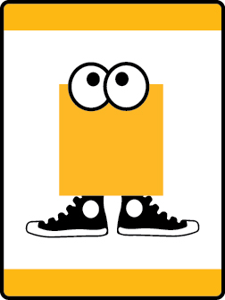

# Gizmos and Gadgets Lion Adventure

- **Adventure name:** Gizmos and Gadgets
- **Rank:** Lion
- **Type:** Elective
- **Category:** 

## Overview

Lions with their adult partner will build a useful object together and explore the properties of motion and force.

## Requirements

### Requirement 1

Explore properties of motion.

**Activities:**

- **[Jumping Cars](https://www.scouting.org/cub-scout-activities/jumping-cars/)** (Indoor, energy 2, supplies 4, prep 3)
  Use Hot Wheels™ cars to conduct some tests of motion.
- **[Moving Marbles](https://www.scouting.org/cub-scout-activities/moving-marbles/)** (Indoor, energy 2, supplies 2, prep 2)
  Make a marble maze out of a paper plate.
- **[On a Roll](https://www.scouting.org/cub-scout-activities/on-a-roll/)** (Indoor, energy 2, supplies 3, prep 2)
  Roll different-sized balls to explore the movement and rotation.
- **[Ping Pong Ball Derby](https://www.scouting.org/cub-scout-activities/ping-pong-ball-derby/)** (Indoor, energy 3, supplies 2, prep 2)
  Race ping pong balls across a table by blowing through a straw.

### Requirement 2

Explore properties of force.

**Activities:**

- **[Cars That Run On Air](https://www.scouting.org/cub-scout-activities/cars-that-run-on-air/)** (Indoor, energy 2, supplies 2, prep 3)
  Build balloon cars to see how air can be a force to move things.
- **[Does This Thing Fly?](https://www.scouting.org/cub-scout-activities/does-this-thing-fly/)** (Indoor, energy 2, supplies 2, prep 1)
  Making paper airplanes and comparing it to paper balls explores the concept of friction as a force.
- **[The Force Pushes and Pulls](https://www.scouting.org/cub-scout-activities/the-force-pushes-and-pulls/)** (Indoor, energy 2, supplies 2, prep 1)
  Cub Scouts identify the difference between pushing and pulling as a force.

### Requirement 3

Use household materials to create a useful object.

**Activities:**

- **[2 Liter Bird Feeder](https://www.scouting.org/cub-scout-activities/2-liter-bird-feeder/)** (Indoor, energy 2, supplies 2, prep 2)
  Make a bird feeder by reusing a 2-liter plastic bottle.
- **[2 Liter Bunny Planter](https://www.scouting.org/cub-scout-activities/2-liter-bunny-planter/)** (Indoor, energy 2, supplies 3, prep 3)
  Make a planter by reusing a 2-liter plastic bottle.
- **[Lion Pinewood Derby® Car Display](https://www.scouting.org/cub-scout-activities/lion-pinewood-derby-car-display/)** (Indoor, energy 2, supplies 4, prep 4)
  Build a Pinewood Derby® car display.

## Resources

- [Gizmos and Gadgets Lion adventure page](https://www.scouting.org/cub-scout-adventures/gizmos-and-gadgets/)

Note: This is an unofficial archive of Cub Scout Adventures that was automatically extracted from the Scouting America website and may contain errors.