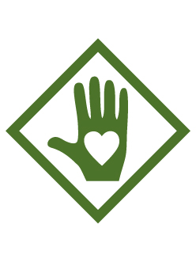

# Aware and Care Webelos Adventure

- **Adventure name:** Aware and Care
- **Rank:** Webelos
- **Type:** Elective
- **Category:** 

## Overview

Everyone has differences, and everyone faces challenges. That’s what makes us human. In this Adventure, you’ll learn about the challenges other people face by looking at the world through their eyes. The more you understand, the more helpful you can be — and the more you can show your friends how to be nice to everyone, including people who are different. After all, we are all different in one way or another.

## Requirements

### Requirement 1

Do an activity that shows the challenges of a being visually impaired.

**Activities:**

- **[Can We Get There?](https://www.scouting.org/cub-scout-activities/can-we-get-there/)** (Indoor, energy 3, supplies 5, prep 5)
  Navigate an obstacle course with both eyes covered one eye covered, and blurred vision.
- **[Can You Draw It?](https://www.scouting.org/cub-scout-activities/can-you-draw-it/)** (Indoor, energy 2, supplies 2, prep 1)
  Draw a picture while vision is obscured.
- **[I Can Do It](https://www.scouting.org/cub-scout-activities/i-can-do-it/)** (Indoor, energy 2, supplies 2, prep 2)
  Pour a cup of water and eat a snack without using vision.
- **[What Is This?](https://www.scouting.org/cub-scout-activities/what-is-this/)** (Indoor, energy 1, supplies 2, prep 2)
  Identify common household items without using vision.

### Requirement 2

Do an activity that shows the challenges of being hearing impaired.

**Activities:**

- **[Listen Carefully](https://www.scouting.org/cub-scout-activities/listen-carefully/)** (Indoor, energy 3, supplies 4, prep 4)
  Play a game of Simon Says wearing noise canceling headphones.
- **[Story Time](https://www.scouting.org/cub-scout-activities/story-time-webelos/)** (Indoor, energy 3, supplies 2, prep 3)
  Tell a story using American Sign Language.
- **[What Animal](https://www.scouting.org/cub-scout-activities/what-animal-webelos/)** (Indoor, energy 3, supplies 2, prep 2)
  Cub Scout guess the animal without talking.

### Requirement 3

Explore barriers to access.

**Activities:**

- **[Can You Reach It?](https://www.scouting.org/cub-scout-activities/can-you-reach-it/)** (Indoor, energy 3, supplies 2, prep 2)
  Cub Scouts experience what it is like to have an object out of reach.
- **[Outdoors Barriers to Access](https://www.scouting.org/cub-scout-activities/outdoors-barriers-to-access/)** (Outdoor, energy 3, supplies 3, prep 2)
  Cub Scouts go outdoors looking for barriers to access.

### Requirement 4

Meet someone who has a disability or someone who works with people with disabilities about what obstacles they must overcome and how they do it.

**Activities:**

- **[How Do People Help?](https://www.scouting.org/cub-scout-activities/how-do-people-help/)** (Travel, energy 2, supplies 1, prep 5)
  Visit a rehabilitation facility.
- **[How Do You Do It?](https://www.scouting.org/cub-scout-activities/how-do-you-do-it/)** (Indoor, energy 2, supplies 1, prep 5)
  Invite a guest to speak about disabilities.
- **[Jobs For Dogs](https://www.scouting.org/cub-scout-activities/jobs-for-dogs/)** (Indoor, energy 1, supplies 1, prep 5)
  Have a person who trains service dogs or has a service dog visit the den.

## Resources

- [Aware and Care Webelos adventure page](https://www.scouting.org/cub-scout-adventures/aware-and-care/)

Note: This is an unofficial archive of Cub Scout Adventures that was automatically extracted from the Scouting America website and may contain errors.