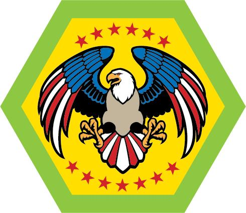

# Military Service and Veterans Merit Badge

## Overview

Honoring Service. Understanding Sacrifice. Inspiring Leadership. The Military Service & Veterans Badge invites Scouts to explore the values, history, and human stories behind military service. Designed to deepen understanding and foster respect, this badge connects Scouts with the heritage of our Armed Forces and the individuals who have served our nation with courage and commitment. Through hands-on learning, meaningful conversations, and active community involvement, Scouts develop a richer appreciation for service, leadership, peace, and patriotism.

## Requirements

- **NOTE:** Check out the Digital Resource Guide for the Military Service and Veterans merit badge [HERE](https://www.scouting.org/skills/merit-badges/digital-resource-guides/military-service-and-veterans/) for detailed information and helpful resources to engage your learning and assist you along on your merit badge journey!

  **Resources:** [HERE](https://www.scouting.org/skills/merit-badges/digital-resource-guides/military-service-and-veterans/)

- (1) **Explore Military Heritage.** Do the following:
  - (a) Learn about Robert Baden-Powell's military service. Discuss with your counselor what he learned about people, values, and culture through his military service and how it influenced the founding of Scouting.

    **Resources:** [Lord Baden-Powell (website)](https://oa-scouting.org/history/lord-baden-powell)
  - (b) Select an historical US military conflict. Discuss with your counselor what caused it and how leadership, planning, or values affected its outcome, how it was resolved, and discuss what lessons can be learned from it.

    **Resources:** [America's Wars (website)](https://department.va.gov/americas-wars/)

- (2) **Understand the Cost of War and the Value of Peace.** Do the following:
  - (a) Discuss with your counselor why military conflict should be a last resort.
  - (b) Do ONE of the following:
    - (1) Read or listen to President Dwight D. Eisenhower's "Atoms for Peace" speech and explain the objectives and role of the International Atomic Energy Agency (IAEA) in promoting peaceful uses of nuclear energy.

      **Resources:** [Atoms For Peace Speech Eisenhower (video)](https://youtu.be/2DxeLeginUQ), [Atoms for Peace Overview (website)](https://www.eisenhowerlibrary.gov/research/online-documents/atoms-peace), [International Atomic Energy Agency (website)](https://www.iaea.org/)
    - (2) Explain the role of the United Nations in promoting peace and resolving international disputes.

      **Resources:** [United Nations Peacekeeping (website)](https://peacekeeping.un.org/en)
    - (3) Reflect on the human and societal costs of war and share the lessons that can be learned from major conflicts.

      **Resources:** [How Conflict Impacts Our Environment (website) (website)](https://www.un.org/en/peaceandsecurity/how-conflict-impacts-our-environment), [The Impact of WWII on European Cities and Infrastructure Explained (website)](https://www.dday.center/the-impact-of-wwii-on-european-cities-and-infrastructure/)

- (3) **United States Armed Forces.** Do the following:
  - (a) Choose one of the branches of service of the United States and research its history, its mission, and its organization. Explain to your counselor what you learned.

    **Resources:** [Learn About the U.S. Military Branches (website)](https://www.usa.gov/us-military)
  - (b) Do ONE of the following:
    - (1) Learn about the Veterans History Project organized by the Library of Congress. Conduct and record an interview of a Veteran using those guidelines. Share your recording with your counselor and the Veteran. With the Veteran's permission, share it with the Library of Congress.

      **Resources:** [Veterans History Project Youth Participation and Guidelines (website)](https://www.loc.gov/programs/veterans-history-project/how-to-participate/customized-guidance/)
    - (2) Select five different conflicts from the Veterans History Project database. Choose a Veteran from each of those five conflicts and study their personal histories.

      **Resources:** [Library of Congress Project Aims To Save Veterans' Stories (video)](https://youtu.be/Y-zMq13vKiY)

- (4) **Understand Military Recognition.** Do the following:
  - (a) Explain the history and significance of the Medal of Honor and the Purple Heart.

    **Resources:** [Medal of Honor: In Their Own Words (video)](https://youtu.be/3ZwXgTnH854), [Medal of Honor History & Recipients (website)](https://www.cem.va.gov/history/Medal-of-Honor-history.asp), [The Origin of the Purple Heart Medal (video)](https://youtu.be/XoS_PVjLxus), [The History of the Purple Heart (website)](https://www.nationalww2museum.org/war/articles/history-of-the-purple-heart)
  - (b) Describe the qualifications for receiving each award.

    **Resources:** [How Is the Medal of Honor Awarded? (website)](https://www.cmohs.org/news-events/blog/how-is-the-medal-of-honor-awarded/#:~:text=Criteria%20to%20Earn%20the%20Medal,enemy%20of%20the%20United%20States%3B)
  - (c) Research a Medal of Honor recipient and share their story with your counselor. Explain why their actions were recognized.

    **Resources:** [Famous American Medal of Honor Recipients  (video)](https://youtu.be/M_t1_fzFSOI), [Medal of Honor Recipients (website)](https://www.cmohs.org/recipients)

- (5) **Military Uniforms and Insignia.** Do the following:
  - (a) Learn about the purpose and history of military uniforms and insignia.

    **Resources:** [The Basics of Military Uniforms (website)](https://www.militaryonesource.mil/military-basics/extended-family-friend/the-basics-of-military-uniforms/)
  - (b) Identify the different uniforms worn by members of the U.S. Army, Navy, Marine Corps, Air Force, Space Force, and Coast Guard.

    **Resources:** [Which US Military Branch Has the COOLEST Uniform? (video)](https://youtu.be/XbTc8ZSsjm0)
  - (c) Learn to identify and describe the rank insignia for all enlisted and officer ranks from one branch of the U.S. Armed Forces.

    **Resources:** [U.S. Military Rank Insignia (website)](https://www.war.gov/Resources/Insignias/#officer-insignia)
  - (d) Explain how rank and insignia show respect, order, and responsibility within the military.

- (6) **Reflect on Symbols of Service.** Do the following:

  **Resources:** [What Does the American Flag Mean to You? (video)](https://youtu.be/MLwa9oAqcVE)

  - (a) Discuss with an Active-duty Member, Reservist, Guardsmen, or Veteran what their uniform and the American Flag mean to them as a military member. Share what you learned with your counselor. Describe what proper respect for the flag means to them.
  - (b) Discuss with your counselor what your uniform and troop flag mean to you.

- (7) **Honor Veterans.** Do the following:
  - (a) Participate in a Veterans Day, Memorial Day, or other event that honors Veterans in your community, school, or place of worship.

    **Resources:** [Honor Fallen Veterans This Memorial Day (website)](https://createthegood.aarp.org/volunteer-ideas/memorial-day-help-veterans.html), [Bet You Didn't Know: Veterans Day \| History  (video)](https://youtu.be/mWD4Oy6fKlo), [History of Veterans Day  (website)](https://department.va.gov/veterans-day/history-of-veterans-day/), [Memorial Day Tribute: May We Never Forget Freedom Isn't Free (video)](https://youtu.be/4VLHEZ6ZUxE)
  - (b) Discuss with your counselor what role you played and what you learned from the experience.
  - (c) Visit a Veterans' organization, military museum, memorial, or cemetery. Discuss with your counselor what you learned about service, sacrifice, and remembrance.

    **Resources:** [Veterans Service Organizations (PDF)](https://www.va.gov/opa/docs/remediation-required/veo/traditionalVeteranOrganizations.pdf), [Military Museums (website)](https://vetsmuseum.org/learn-more/military-museums/), [Veterans Memorials (website)](https://rememberingveterans.org/veterans-memorials-locator/), [Find a Cemetary (website)](https://www.cem.va.gov/find-cemetery/)

- (8) **Military Academies.** Do the following:
  - (a) Learn about the purpose and history of TWO of the U.S. military academies. Discuss what you learned with your counselor.
  - (b) Explain the general requirements for admission to one of these academies.

    **Resources:** [Service Academy Nomination Process (website)](https://www.whitehouse.gov/service-academy-nomination/)
  - (c) Describe how attending a service academy prepares a person for military leadership and service to the nation.

    **Resources:** [The Five-Pointed Star: U.S. Service Academies (video)](https://youtu.be/FMGzUJnXssI)
  - (d) Discuss with your counselor how the values of Scouting align with those of the military academies.

    **Resources:** [The Honor Concept (video)](https://youtu.be/geMiyyQnXC4)

- (9) **Inspire Service and Leadership.** Do the following:
  - (a) Discuss how learning about Veteran and military service can inspire youth to serve their community and country.

    **Resources:** [Scoutmaster Talks About How Military Life Affects Scouting (video)](https://youtu.be/ZffcUB1ZlxM), [21 Strengths Arising From Military Experience (PDF)](https://ucnet.universityofcalifornia.edu/wp-content/uploads/working-at-uc/your-career/veterans/_files/21_Strengths_Arising_From_Military_Experience.pdf)
  - (b) List two ways you can demonstrate courage, service, or leadership in your daily life.

    **Resources:** [6 Ways Students Can Demonstrate Leadership (website)](https://www.colorado.edu/orientation/2024/02/29/6-ways-students-can-demonstrate-leadership)
  - (c) Research service projects in your area that honor Veterans or support those currently serving. Share what you learned with your counselor.

    **Resources:** [Quilts of Valor (video)](https://youtu.be/fMZbL0MjEB4), [Volunteer To Help Veterans (website w/ video)](https://www.dav.org/get-involved/volunteer/volunteer-locally-to-help-veterans/)

- (10) **Careers/Hobby.** Do ONE of the following:
  - (a) Explore careers related to this merit badge. Research one career to learn about the training and education needed, costs, job prospects, salary, job duties, and career advancement. Your research methods may include—with your parent or guardian's permission—an internet or library search, an interview with a professional in the field, or a visit to a location where people in this career work. Discuss with your counselor both your findings and what about this profession might make it an interesting career.

    **Resources:** [Air Force Jobs (video)](https://youtu.be/0Ewqo-_4Cpw), [These Military Jobs Lead to $100K+ Civilian Careers  (video)](https://youtu.be/aWArkLWjN6U), [Top 5 Paying Army Jobs for Civilian Careers! (video)](https://youtu.be/qwnzElkiiCs)
  - (b) Explore how you could use knowledge and skills from this merit badge to pursue a hobby or volunteer activity, or healthy lifestyle. Research any training needed, expenses, and organizations that promote or support it. Discuss with your counselor what short-term and long-term goals you might have if you pursued this.

    **Resources:** [US Coast Guard Auxilliary (video)](https://youtu.be/lO1XXV97lII), [Civil Air Patrol (video)](https://youtu.be/O8onxUMqrsw), [JROTC (video)](https://youtu.be/wKN3qOHH0OM), [Honor Flights (video)](https://youtu.be/9E7GLdYhm3s), [Toy Soldier Collection (video)](https://youtu.be/xeTad9uhO0k), [American Legion Youth Programs (video)](https://youtu.be/sp5mqqgOqLI), [Building Your First Scale Model Figure! (video)](https://youtu.be/dGD__hEQp5g), [Ham Radio (video)](https://youtu.be/hbbHHo53yQ0)

## Resources

- [Military Service and Veterans merit badge page](https://www.scouting.org/merit-badges/military-service-veterans/)

Note: This is an unofficial archive of Scouts BSA Merit Badges that was automatically extracted from the Scouting America website and may contain errors.